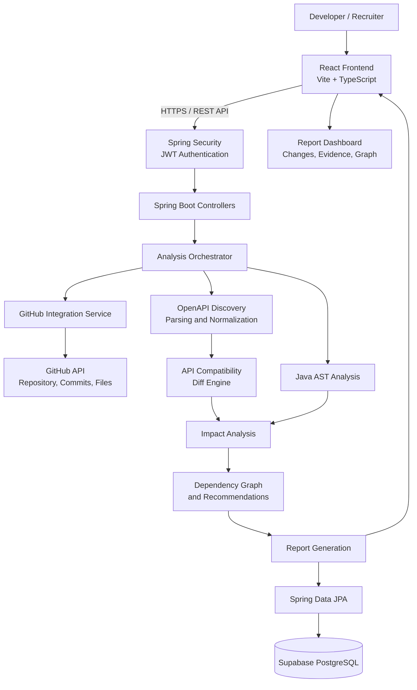
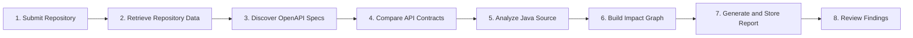
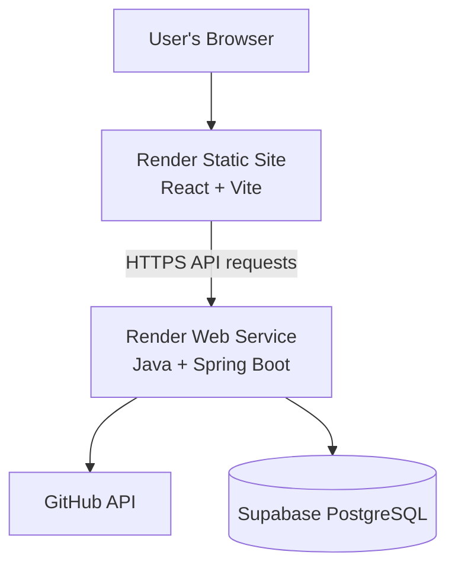

# 🚀 API Analyzer
### Detect API Changes. Understand the Impact. Ship Safer Releases.

**API Analyzer** is a full-stack developer tool that analyzes GitHub repositories, compares API specifications, identifies potentially breaking API changes, and traces their impact on Java source code.

Instead of manually reviewing API changes across a codebase, developers can use API Analyzer to understand what changed, why it matters, and which components may require updates before a release.

<p align="center">
  
  
  
  
  
  
</p>

---

## 📌 Table of Contents

- [Overview](#-overview)
- [Problem Statement](#-problem-statement)
- [Key Features](#-key-features)
- [System Architecture](#-system-architecture)
- [How It Works](#-how-it-works)
- [Technology Stack](#-technology-stack)
- [Project Structure](#-project-structure)
- [Getting Started](#-getting-started)
- [Environment Variables](#-environment-variables)
- [Running Locally](#-running-locally)
- [Testing](#-testing)
- [Deployment on Render](#-deployment-on-render)
- [Security](#-security)
- [Limitations](#-limitations)
- [Future Improvements](#-future-improvements)
- [Author](#-author)

---

## 🎯 Overview

API Analyzer combines API contract analysis with source-code impact analysis to help developers evaluate the consequences of changing an API.

The application connects to GitHub, retrieves repository information and relevant source files, discovers OpenAPI specifications, compares API contracts, and analyzes Java code to identify potentially affected components.

The resulting report presents detected changes, severity classifications, impact relationships, and actionable recommendations.

### The goal

**Make API changes easier to understand before they become production problems.**

## ❗ Problem Statement

API changes can unintentionally break existing clients and downstream services.

For example, removing an endpoint, introducing a required request parameter, or changing a response schema may cause previously working integrations to fail.

Traditional code reviews can miss these consequences when API contracts and their consumers are spread across multiple files and modules.

API Analyzer addresses this challenge by bringing together:

- API specification discovery and comparison.
- Breaking-change classification.
- Java source-code analysis.
- Dependency and impact visualization.
- Evidence-based reports and recommendations.

## ✨ Key Features

### 🔗 GitHub Integration
- Connect to GitHub repositories.
- Retrieve repository metadata, branches, commits, and source files.
- Support authenticated GitHub API requests.
- Handle API errors and rate limits explicitly.

### 📄 OpenAPI Specification Analysis
- Discover API specifications in common repository locations.
- Parse supported OpenAPI/Swagger JSON and YAML documents.
- Normalize API definitions before comparison.
- Compare API contracts across available revisions.

### ⚠️ Semantic API Change Detection
Identify potentially breaking changes such as:

- Removed API endpoints or operations.
- Newly required parameters.
- Required request-body changes.
- Removed response status codes.
- Response schema changes.
- Removed supported media types.
- Removed enum values.

Classification depends on the available specifications and the implemented compatibility rules.

### ☕ Java Source-Code Analysis
- Parse Java source code using an AST-based approach.
- Extract relevant Spring endpoint annotations and source locations.
- Analyze relationships between controllers, services, and other components.
- Associate detected API changes with potentially affected source files where evidence is available.

### 🕸️ Impact Graph
Visualize relationships between API changes and source-code components using an interactive graph.

### 📊 Analysis Reports
- Summarize detected API changes.
- Present severity and compatibility classifications.
- Show affected files and supporting evidence where available.
- Display dependency relationships and recommendations.
- Persist analysis results for subsequent retrieval.

### 🔐 Authentication and Data Protection
- JWT-based authentication.
- Password hashing using BCrypt.
- Configurable cross-origin access.
- Encrypted storage for supported sensitive values.
- Environment-based configuration for credentials and cryptographic keys.

### ⚙️ Asynchronous Processing
Long-running analysis tasks can be processed asynchronously so the interface can track analysis progress without waiting for every repository operation to finish.

---

## 🏗️ System Architecture

The following diagram shows the intended request flow and the major application components.



### Architecture responsibilities

| Component | Responsibility |
|---|---|
| React frontend | Repository input, analysis status, report visualization |
| Spring Boot backend | API endpoints, orchestration, business logic |
| GitHub integration | Repository metadata and source retrieval |
| OpenAPI analysis | Specification discovery, parsing, normalization |
| Compatibility engine | Semantic API change classification |
| Java AST analyzer | Source structure and endpoint analysis |
| Impact analysis | Connect API changes with potentially affected components |
| PostgreSQL | Persist projects, analysis results, and related records |
| Supabase | Managed PostgreSQL hosting |
| Render | Application deployment and hosting |

The diagram represents the application's logical architecture. Exact request paths, background-processing behavior, and persisted entities depend on the implemented application configuration.

## 🔄 How It Works



**Step 1 — Submit a repository**

The user provides the repository information and the supported comparison inputs.

**Step 2 — Retrieve repository data**

The backend fetches the relevant metadata, revisions, and source files through the GitHub API.

**Step 3 — Discover API specifications**

The application searches supported repository locations for OpenAPI/Swagger specifications and parses the available definitions.

**Step 4 — Compare API contracts**

The compatibility engine evaluates the differences between the selected API definitions and classifies supported changes.

**Step 5 — Analyze Java source code**

The Java analyzer examines source structures, endpoint annotations, and component relationships.

**Step 6 — Build the impact graph**

The system connects detected changes with potentially affected components where sufficient evidence exists.

**Step 7 — Generate and store the report**

The backend prepares the analysis results and persists supported report data.

**Step 8 — Review findings**

The frontend displays the report, including detected changes, severity, source references, impact relationships, and recommendations where available.

---

## 🧰 Technology Stack

| Layer | Technologies |
|---|---|
| Programming languages | Java 21, TypeScript, JavaScript |
| Backend framework | Spring Boot 3.2 |
| Backend security | Spring Security, JWT, BCrypt |
| Frontend | React 18, Vite |
| Styling | Tailwind CSS |
| Visualization | React Flow |
| HTTP communication | REST APIs, Axios |
| Persistence | Spring Data JPA, Hibernate |
| Database | PostgreSQL |
| Database hosting | Supabase |
| API specifications | OpenAPI / Swagger, JSON, YAML |
| Source analysis | Java AST-based parsing |
| Build tooling | Maven, npm |
| Version control | Git, GitHub |
| CI/CD | GitHub Actions |
| Hosting | Render |

> Versions shown here describe the project's intended stack. Check the current dependency files for exact versions and configuration.

## 📁 Project Structure

The repository is organized into frontend and backend applications, along with supporting deployment and automation files.

```text
API-analyzer/
├── frontend/
│   ├── public/
│   ├── src/
│   │   ├── components/
│   │   ├── pages/
│   │   ├── services/
│   │   └── ...
│   ├── package.json
│   └── vite.config.ts
│
├── backend/
│   ├── app-runner/
│   ├── module-analysis/
│   ├── module-core/
│   ├── module-migration/
│   ├── pom.xml
│   ├── mvnw
│   ├── mvnw.cmd
│   └── Dockerfile
│
├── .github/
│   └── workflows/
├── README.md
└── docker-compose.yml
```

*The tree is representative. Keep only paths and modules that exist in the current repository when updating this documentation.*

## 🚀 Getting Started

### Prerequisites

Install the following tools before running the project locally:

- Java Development Kit (JDK) 21.
- Git.
- Node.js and npm, compatible with the frontend project.
- Docker, if running the backend as a container.
- A Supabase PostgreSQL database, or another supported PostgreSQL instance.
- A GitHub personal access token for authenticated repository access.

### Clone the repository

```bash
git clone https://github.com/RaviTeja-sjc/API-analyzer.git
cd API-analyzer
```

### Configure the environment

Create the necessary environment variables for the frontend and backend. See [Environment Variables](#-environment-variables).

Do not commit `.env` files, database credentials, personal access tokens, or production secrets.

## 🔧 Environment Variables

Configure these variables in your local environment and deployment provider as applicable.

### Backend

| Variable | Purpose |
|---|---|
| `PORT` | Port used by the backend hosting environment |
| `SPRING_PROFILES_ACTIVE` | Spring profile, such as `prod` |
| `DATABASE_URL` | PostgreSQL connection URL |
| `DATABASE_USER` | Database username, if separately configured |
| `DATABASE_PASSWORD` | Database password, if separately configured |
| `JWT_SECRET` | Secret used to sign and validate JWTs |
| `DB_ENCRYPTION_KEY` | Key used by the application's encryption service |
| `GITHUB_TOKEN` | GitHub token for authenticated API access |
| `CORS_ALLOWED_ORIGINS` | Allowed frontend origins |

The database URL format and whether credentials are separate depend on the project's Spring configuration. Follow the existing `application.yml` and production profile configuration.

Use strong, unique production secrets. Generate cryptographic keys that meet the exact encoding and length requirements enforced by the implementation.

### Frontend

| Variable | Purpose |
|---|---|
| `VITE_API_BASE_URL` | Base URL used by the frontend to call the backend API |

For local development, set this to the backend URL and API prefix expected by the frontend. For production, set it to the deployed backend's HTTPS URL and the correct API prefix, such as `/api/v1`, if required by the current code.

Vite exposes variables prefixed with `VITE_` to browser-side code. **Never put private credentials or server-side secrets in frontend environment variables.**

## 💻 Running Locally

### 1. Start the backend

Open a terminal in the backend directory:

```bash
cd backend
```

Build the Maven project:

**Windows**

```powershell
.\mvnw.cmd clean package
```

**Linux / macOS**

```bash
./mvnw clean package
```

If the project uses a multi-module Maven build, run the build from the parent directory containing the root `pom.xml`.

After a successful build, start the executable JAR produced by the `app-runner` module. Use the actual JAR filename in `backend/app-runner/target/`.

For example:

```bash
java -jar app-runner/target/app-runner-1.0.0-SNAPSHOT.jar
```

If you use a production Spring profile locally, ensure all required database and security environment variables are configured before starting the application.

### 2. Start the frontend

Open a separate terminal:

```bash
cd frontend
npm install
npm run dev
```

Open the local URL printed by Vite, typically:

```text
http://localhost:5173
```

Ensure `VITE_API_BASE_URL` points to your running backend and that the backend permits requests from the local frontend origin.

### 3. Verify the application

- Confirm the backend starts without database or configuration errors.
- Confirm the frontend loads.
- Submit a repository supported by the analyzer.
- Verify that analysis progress and the resulting report are displayed correctly.
- Inspect backend logs if GitHub requests, specification parsing, or database operations fail.

---

## 🧪 Testing

The project uses automated tests to help validate backend and frontend behavior.

### Backend tests

Run from the backend parent directory:

```bash
.\mvnw.cmd test
```

On Linux or macOS:

```bash
./mvnw test
```

If you want to test only specific Maven modules, use their actual artifact/module names and the test command configured for the repository.

### Frontend tests

Run from the frontend directory:

```bash
npm install
npm test
```

Use the test script supported by the current `package.json`. If the project defines separate scripts for unit tests, linting, or production builds, run those as well.

### Recommended validation scenarios

| Scenario | Expected behavior |
|---|---|
| Compatible API change | Report the change without incorrectly treating it as breaking |
| Breaking API change | Identify the change and explain the compatibility concern |
| Missing OpenAPI specification | Display a clear limitation or unsupported-input state |
| Invalid specification | Return an actionable parsing error |
| GitHub rate limit | Report the rate-limit condition rather than silently showing an empty report |
| Unavailable repository | Display an appropriate access or repository error |
| No detected changes | Distinguish a verified no-change result from a failed or incomplete analysis |
| Database unavailable | Report the persistence or connection failure clearly |

Passing unit tests alone does not guarantee that every external repository, API specification, or production deployment will work. End-to-end validation should use real repositories and known comparison revisions.

---

## ☁️ Deployment on Render

The application has two separately deployable application components:

1. **Frontend:** Render Static Site.
2. **Backend:** Render Web Service using the existing Dockerfile.

Supabase remains the managed PostgreSQL database.

### Deployment architecture



### 1. Deploy the backend

1. Push the latest working code to GitHub.
2. Open the [Render Dashboard](https://dashboard.render.com/).
3. Create a new **Web Service** and connect your GitHub repository.
4. Configure the service to use the repository's backend Docker build context and Dockerfile.
5. Add all required backend environment variables in Render's environment settings.
6. Configure the database connection, GitHub token, JWT secret, encryption key, and production CORS settings.
7. Deploy and wait for the build and startup process to complete.

Use the actual Docker configuration in your repository. If the Dockerfile is located at `backend/Dockerfile`, configure the build context as `backend` and the Dockerfile path according to Render's current settings.

If an HTTP health endpoint is configured, use the endpoint that actually exists in the backend. Do not assume that a health path works unless it has been verified.

**Backend verification:** Open the deployed service's public URL or its configured health endpoint. Confirm that the service starts successfully and that its logs show a successful database connection.

### 2. Deploy the frontend

1. In Render, create a new **Static Site**.
2. Connect the same GitHub repository.
3. Set the root directory to `frontend`.
4. Set the build command to:

   ```bash
   npm install && npm run build
   ```

5. Set the publish directory to:

   ```text
   dist
   ```

6. Add the frontend environment variable:

   ```text
   VITE_API_BASE_URL
   ```

   Set its value to your deployed backend URL, including the API prefix required by the frontend.

7. Deploy the static site.

### 3. Configure CORS

After the frontend has a public URL, configure the backend's `CORS_ALLOWED_ORIGINS` to allow that exact frontend origin.

For example, if the deployed frontend URL is `https://your-frontend.onrender.com`, configure that origin using the format expected by the application.

Do not allow arbitrary origins in production unless there is a specific, justified requirement.

### 4. Verify the complete deployment

- Open the frontend's public URL.
- Confirm that the frontend can reach the backend.
- Sign in or authenticate using the application's supported flow.
- Analyze a repository you have permission to access.
- Confirm that real API changes and supporting evidence appear in the report.
- Verify that reports can be retrieved after the analysis finishes.
- Check backend logs for GitHub API failures, database errors, and CORS issues.

### Important hosting considerations

Render's free services may spin down after inactivity, causing cold starts. Free-tier availability, limits, and database behavior can change.

For a recruiter demonstration, check the current plan limitations and make sure the application has been tested after periods of inactivity.

Deployment does not replace security testing or verification of the analysis results.

---

## 🔐 Security

Security is important because the application accesses external repositories and may store authentication-related data.

The project incorporates security-related mechanisms such as:

- JWT-based authentication.
- BCrypt password hashing.
- Environment-based secret management.
- Encrypted storage for supported sensitive values.
- Configurable CORS policies.
- Authenticated GitHub API requests.
- Error handling for external API failures.

### Production recommendations

- Never commit credentials or production secrets to GitHub.
- Use a token with only the permissions required by the application.
- Avoid logging tokens, passwords, encryption keys, or authorization headers.
- Keep dependencies updated and review security advisories.
- Validate and constrain user-supplied repository URLs and other external inputs.
- Ensure that external API errors cannot be mistaken for successful empty analyses.
- Verify authorization before allowing access to private projects or reports.
- Restrict network access and external URL fetching wherever applicable.

These measures describe implementation areas and recommended practices; they should not be interpreted as a guarantee that the application is vulnerability-free.

## ⚠️ Limitations

API Analyzer is intended to assist developers with impact assessment, not replace engineering review.

- Analysis quality depends on the API specifications and source files available to the application.
- Repositories without discoverable API contracts may provide limited API compatibility insights.
- Source-code relationships may be incomplete when dependencies or calls cannot be resolved.
- Compatibility classification depends on the rules implemented by the analysis engine.
- GitHub rate limits, private repository permissions, and network failures can affect analysis.
- Generated recommendations require developer review before implementation.
- A report cannot guarantee that all runtime, integration, or backward-compatibility issues have been detected.

## 🛣️ Future Improvements

Potential areas for further development include:

- Pull request integration with automated API-change checks.
- Additional language and framework support.
- More advanced dependency and call-graph resolution.
- Custom compatibility policies.
- Improved report export and sharing.
- Historical API compatibility trends.
- CI/CD gates for configurable breaking-change thresholds.
- More comprehensive end-to-end and performance testing.

## 👨‍💻 Author

**Ravi Teja**

Final-year BCA student interested in backend development, software engineering, and practical developer tools.

- GitHub: [RaviTeja-sjc](https://github.com/RaviTeja-sjc)
- Project Repository: [API Analyzer](https://github.com/RaviTeja-sjc/API-analyzer)

---

<p align="center">
  <b>Built to help developers understand API changes before they become production problems.</b>
</p>
